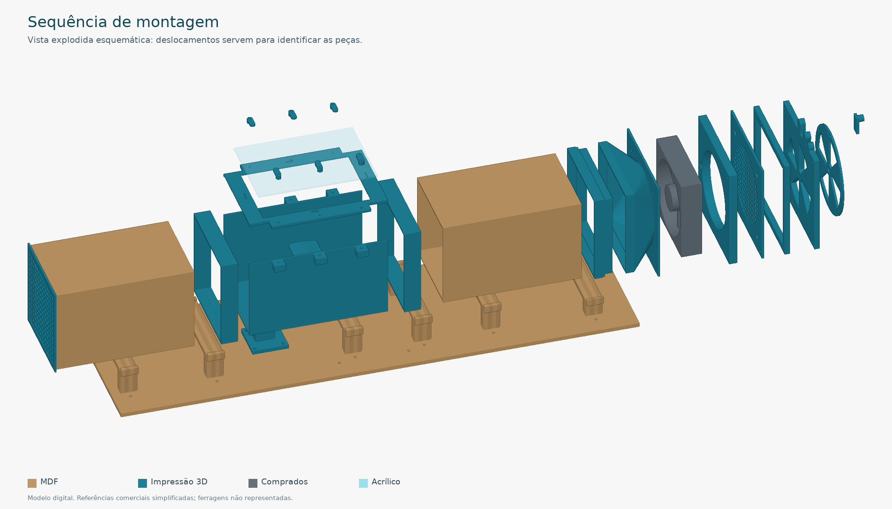
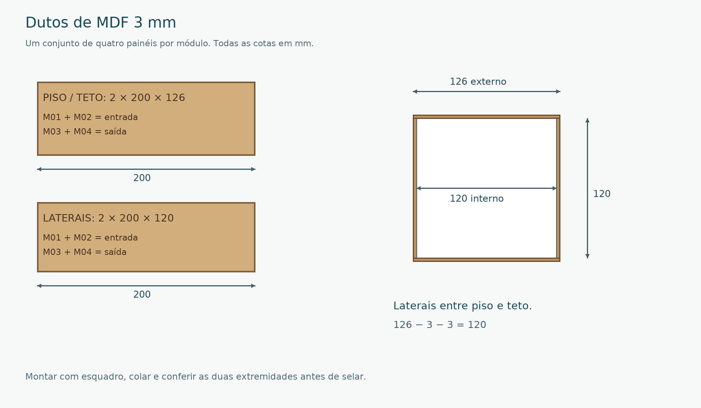
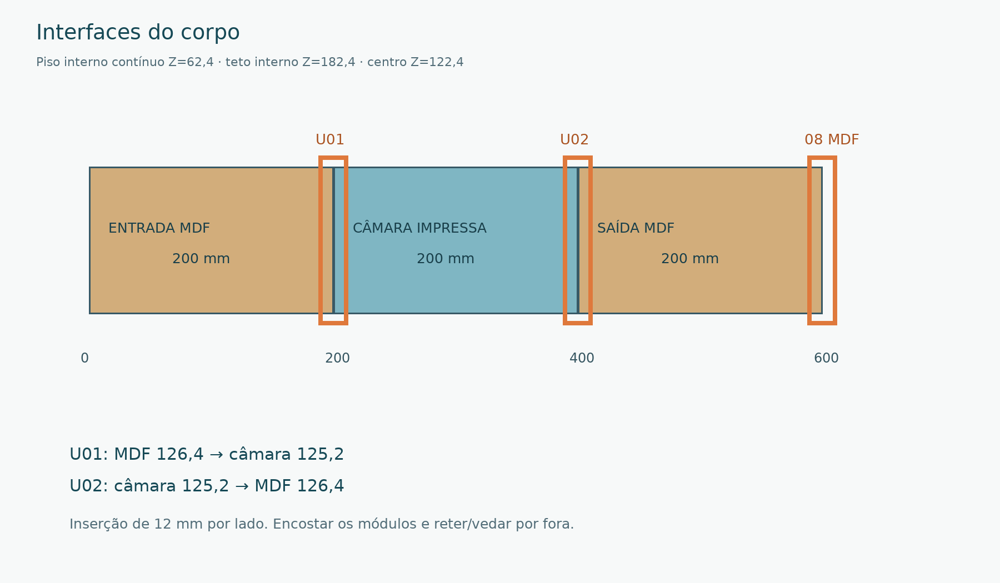
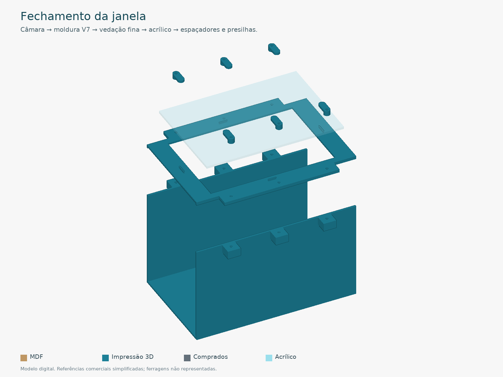
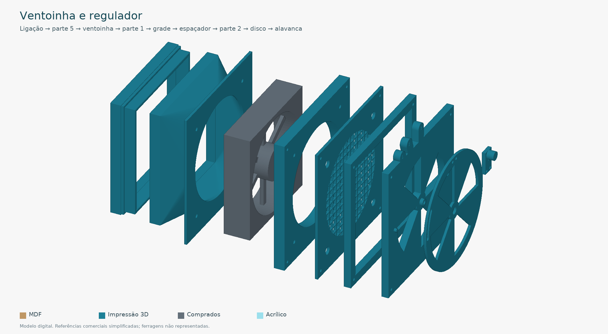

# Guia de montagem · Túnel Híbrido V7

Este roteiro organiza a montagem do pacote final recebido. As medidas estão em **milímetros**. Consulte o [manual técnico ilustrado](../modelos-3d/04_DOCUMENTOS/01_GUIA_MONTAGEM.md) para desenhos, coordenadas e detalhes de cada fixação; ele é a referência técnica deste roteiro.

## 1. Separar materiais e escolher variantes

Use a [lista de fabricação](../modelos-3d/04_DOCUMENTOS/02_LISTA_FABRICACAO.md) para as quantidades e a [lista de compras](../modelos-3d/04_DOCUMENTOS/03_LISTA_COMPRAS.md) para ferragens e componentes. Prepare paquímetro, esquadro, grampos, cola para MDF, broca Ø4,5, ferramentas para os parafusos e transferidor.

- Dutos: MDF 3 mm. Apoios e base opcional: MDF 6 mm. Tampa: acrílico 172 × 120 × 3.
- Imprima as 29 peças padrão dos 19 STL, incluindo seis presilhas e seis espaçadores da tampa.
- Escolha **uma asa**: A simétrica ou B curvada. A asa B substitui somente a asa A.
- Escolha **uma ligação MDF/parte 5**: padrão 126,2 ou alternativa 126,0/125,8, conforme cupom. Essas variantes substituem somente a ligação correspondente.
- Corte as chapas **ou** as peças individuais. Importe SVG **ou** DXF, em escala 1:1. As chapas já incluem as quantidades; não duplique cortes.

## 2. Testar antes de fabricar o lote

Meça a espessura real do MDF e faça os cupons de laser e impressão em suas pastas de testes. Não ajuste a escala geral para compensar material ou encaixe.

- Monte o tubo curto com dois T01 e dois T02 em MDF: interior 120 × 120 e exterior nominal 126 × 126.
- Confira o kerf com T03 de MDF e teste o tubo no cupom impresso T08.
- Teste os machos T07 na parte 5 antes de escolher a ligação definitiva.
- Confira os furos da ventoinha real com T05: os STL usam **105 mm entre centros**.
- Teste janela com T03/T04 impressos, uma presilha e um espaçador; confira a célula real com T06, incluindo rosca e profundidade útil.

**Avance quando:** os encaixes entrarem à mão e a ventoinha e a célula reais forem compatíveis. Os IDs T03 de MDF e T03 impresso são testes diferentes.

## 3. Colar entrada e saída

Monte a entrada com 2 × M01 (200 × 126) e 2 × M02 (200 × 120). Monte a saída com 2 × M03 (200 × 126) e 2 × M04 (200 × 120).

As laterais de 120 ficam **entre piso e teto**, alinhadas às bordas externas. Faça montagem a seco, confira esquadro e diagonais, cole as juntas longitudinais e aguarde a cura. Remova ressaltos internos. Aplique selador compatível, aguarde a cura e repita o teste das luvas.

**Avance quando:** os dois dutos tiverem passagem livre de 120 × 120, extremidades alinhadas e encaixes sem força excessiva.

## 4. Preparar seis apoios e painel

Cole quatro lâminas por apoio: quatro apoios M13, um M23 e um M19. São **24 lâminas**, resultando em apoios de 24 mm na direção longitudinal. Não troque os tipos: suas alturas diferem.

| Apoio | Posição X no painel | Altura do patamar |
|---|---|---|
| M13 | 25, 150, 450 e 550 | 59,4 |
| M23, câmara | 350 | 60,0 |
| M19, conjunto externo | 695 | 47,4 |

Após a colagem, fure verticalmente com Ø4,5 usando G13 para M13/M23 e G19 para M19. Para a base opcional, una B01/B02 formando 750 × 220 e instale as duas talas B03 por baixo, conforme o manual.

Use 12 M4 × 20 nos seis apoios, mais quatro na base do sensor. A base bipartida usa ainda quatro M4 escareados × 20 nas talas. Confira comprimento real e engate das porcas. Reserve pelo menos 20 mm livres sob o painel.

**Avance quando:** painel e apoios estiverem firmes e planos. A base opcional de 6 mm precisa ter sua rigidez conferida na montagem real.

## 5. Montar o corpo e alinhar o canal

No sentido do ar, posicione entrada X=0–200, câmara X=200–400 e saída X=400–600. A origem é a face de entrada do corpo, antes da aba da colmeia.

1. Instale U01 na emenda X=200: lado 126,4 para MDF, lado 125,2 para câmara.
2. Instale U02 na emenda X=400: lado 125,2 para câmara, lado 126,4 para MDF.
3. Encoste os módulos sem folga axial. Confira os cinco apoios do corpo e o piso interno contínuo em Z=62,4.
4. Retenha as luvas e vede externamente com fita removível.
5. Instale a colmeia com canais entrando 46 mm no duto e aba para fora; retenha a aba externamente.
6. Coloque a ligação MDF/parte 5 na saída. Apoie o conjunto externo no M19 antes de apertá-lo.

**Avance quando:** o canal estiver alinhado, sem degraus, folgas abertas ou peças soltas.

## 6. Instalar célula e asa antes de fechar a janela

Confirme a rosca e a profundidade útil da célula real. Fixe sua extremidade à base 14 com os parafusos entrando por baixo **antes de prender essa base ao painel**. Mantenha o trecho central da célula livre.

Prenda a base nos quatro furos X=220/261 e Y=±22. Instale espaçador 15 e suporte 16 na extremidade móvel com os parafusos adequados à célula. Passe as hastes pelos rasgos sem contato com o corpo. Instale uma asa com M3 × 35 e ajuste o ângulo com transferidor.

**Avance quando:** a asa puder ser posicionada em −20°, −15°, 0°, 15° e 20° sem contato, as hastes estiverem livres e os fios não tracionarem o sensor. O apoio M23 não pode tocar a parte móvel.

## 7. Fechar a janela

Use somente a moldura final **04_moldura_V7_passagem_120mm.stl**. Retire suportes de impressão e confira os seis furos. Assente a moldura, aplique vedação fina (referência de aproximadamente 0,5 mm comprimida) e coloque a tampa de acrílico sem furá-la.

Instale seis espaçadores de 3,5 mm e seis presilhas giratórias, usando M3 × 25 como referência inicial. Confira a pilha real e use maior comprimento se necessário. Aperte até reter a tampa sem flexioná-la. Repita a conferência de movimento da asa.

## 8. Instalar ventoinha e regulador

**Ordem no sentido do ar:** ligação MDF → parte 5 → ventoinha → parte 1 → grade 09 → espaçador 20 → parte 2 → parte 3 invertida → alavanca parte 4.

- Fixe parte 5, ventoinha e parte 1 com quatro M4 × 55. A ventoinha deve puxar ar pelo túnel e expulsá-lo pelo regulador.
- Na parte 2, ressalto e pino ficam para fora. Inverta a parte 3; os rebaixos cônicos ficam voltados à parte 2.
- Fixe a alavanca à parte 3 com dois M3 escareados × 12. Na abertura máxima, alavanca para cima e janelas alinhadas.
- Use M4 × 20 no eixo, com arruela de retenção de diâmetro externo próximo de 12 mm apoiada no ressalto, sem prensar o disco.
- Una parte 1, grade, espaçador e parte 2 com quatro M3 × 40. Confira que nenhuma ponta toca pás ou disco.

**Avance quando:** o conjunto estiver apoiado no M19 e pás e regulador girarem manualmente com a fonte desligada. O regulador não fecha completamente; suas marcações não indicam velocidade ou porcentagem de vazão.

## 9. Checklist antes do primeiro ensaio

- [ ] Variantes, quantidades e espessuras conferidas.
- [ ] Seis apoios fixos, base estável e folga inferior para ferragens.
- [ ] Canal alinhado, limpo e vedado; luvas e colmeia retidas.
- [ ] Tampa presa sem flexão e moldura V7 instalada.
- [ ] Célula, hastes, asa e fios livres de contatos parasitas.
- [ ] Pás, grade, regulador e pontas dos parafusos conferidos com a fonte desligada.
- [ ] Alimentação e eletrônica definidas para os componentes reais, antes de energizar.
- [ ] Tara sem vento, calibração com massas conhecidas e ensaio do suporte sem asa realizados.
- [ ] Vibração, vazamentos e repetibilidade avaliados e registrados em `dados/`.

O pacote é mecânico: não fornece dimensionamento elétrico ou firmware pronto. Registre componentes, condições de ensaio, ângulo da asa e resultados. O sensor mede uma componente de força; não separa sustentação e arrasto simultaneamente.

## Referências e limites

O [manual original em PDF](../modelos-3d/04_DOCUMENTOS/01_GUIA_MONTAGEM.pdf) acompanha este roteiro. Os [relatórios digitais](../modelos-3d/04_DOCUMENTOS/04_VERIFICACAO_MODELO.md) documentam a análise feita pelo autor do pacote; não substituem montagem física, ensaios de carga, vedação ou calibração. A [procedência da importação](PROCEDENCIA_V7.md) distingue essas verificações da conferência de integridade executada neste repositório.
